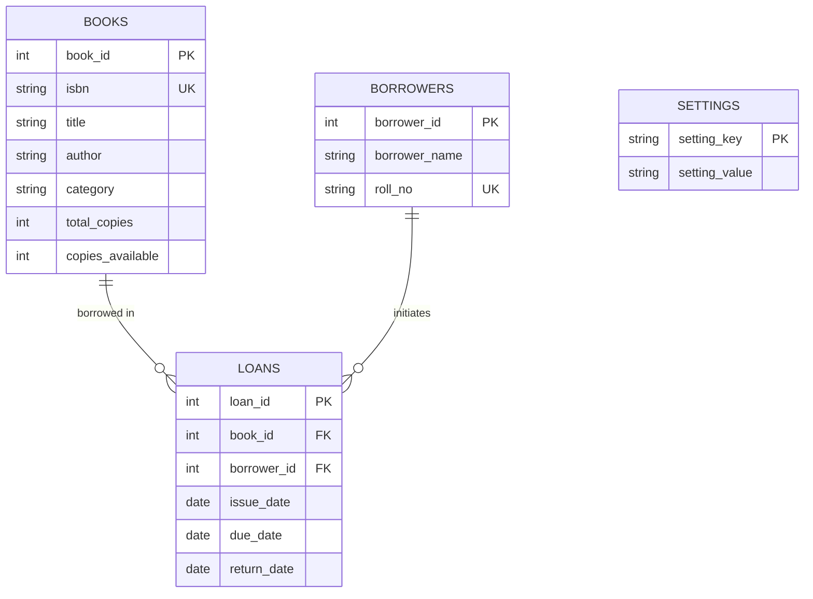

# Library Book Usage Analysis System

A modern, responsive, full-stack web application designed for comprehensive library management and data-driven circulation analysis. The platform manages book inventories, borrower records, and borrowing transactions while providing deep analytical insights into monthly borrowing trends, high-demand literature, category distribution, and delinquent overdue loans.

---

## Key Features

1. **Executive Dashboard**:
   - Live KPI cards: Total Books, Total Borrowers, Available Copies, Active Loans, Overdue Loans, and Total Borrowing Transactions.
   - Dynamic interactive charts powered by **Chart.js**:
     - *Monthly Borrowing Trends* (smooth line chart with gradient fill)
     - *Most Borrowed Books* (horizontal/vertical bar chart)
     - *Books by Category* (multi-color pie chart)
     - *Active vs. Returned Loans* (doughnut chart with status breakdown)
   - Real-time recent transaction tracking with status badges.

2. **Book Inventory Management**:
   - Full CRUD operations: Add new book, view catalog, edit details, and safely delete books.
   - Referential integrity safeguard: Prevents deletion of books that have borrowing history.
   - Multi-column search (Title, Author, ISBN, Category) and Category filter dropdown.
   - Real-time stock badge indicators (`In Stock` vs `Out of Stock`).

3. **Borrower Management**:
   - Register patrons, view borrower profiles, edit information, and delete records.
   - Deletion protection: Patrons with unreturned active loans cannot be deleted.
   - Tracks total historical loans and currently active loans per patron.

4. **Circulation Management (Issue & Return)**:
   - **Issue Book**: Select available book and borrower, automatic issue date population, and automated due date calculation based on configurable loan periods (default: 14 days).
   - **Return Book**: Visual overview of active loans, auto-populated return date, and one-click check-in.
   - **Atomic Database Transactions**: Each issue atomically decrements `copies_available` by 1; each return increments `copies_available` by 1.

5. **Overdue Loan Analysis**:
   - Automated detection where `return_date IS NULL` and `due_date < CURDATE()`.
   - Computes exact days overdue, average delinquency, and maximum overdue durations.
   - Direct "Check In" modal right from the overdue loans table.

6. **Advanced Data Science & Statistical Analytics**:
   - **Pandas**: Grouping, time-series aggregation, and rolling metrics.
   - **NumPy**: Statistical calculations including mean per month, sample standard deviation ($\sigma$), median (50th percentile), and min/max.
   - **Matplotlib**: Generates high-resolution PNG analytical charts downloadable on-demand.

7. **Reports & Data Export**:
   - 6 Administrative Reports:
     1. Most Borrowed Books Report
     2. Overdue Loans Report
     3. Monthly Borrowing Trends Report
     4. Category-Wise Distribution Report
     5. Active Loans Report
     6. Returned Books Audit Report
   - One-click CSV spreadsheet export for every report.
   - Date-range filtering for periodic auditing.

8. **Configurable Settings & Diagnostics**:
   - Adjust default borrowing duration (1 - 365 days) saved directly to database.
   - Live database connection diagnostics (Host, Port, Engine, Health, and Latency).

---

## Technology Stack

- **Frontend**: HTML5, CSS3, JavaScript (ES6+), Bootstrap 5.3, Bootstrap Icons, Chart.js 4.4.
- **Backend**: Python 3.10+, Flask 3.1, Pandas 3.1, NumPy 2.5, Matplotlib 3.11, python-dotenv.
- **Database**: MySQL 8.0 (PyMySQL connector) with proper Primary/Foreign Keys, indexes, constraints, and automatic local SQLite compatibility fallback.

---

## Windows Installation & Running Instructions

### 1. Prerequisites
Ensure you have the following installed on Windows:
- **Python 3.10 or higher** (Ensure "Add Python to PATH" was selected during install)
- **MySQL Server 8.0** (Community Edition)

Verify versions in PowerShell or Command Prompt:
```powershell
python --version
mysql --version
```

---

### 2. Project Directory Setup
Open PowerShell and navigate to the project directory:
```powershell
cd C:\Users\kuruv\.gemini\antigravity\scratch\library_book_analysis
```

---

### 3. Create and Activate a Python Virtual Environment
```powershell
# Create virtual environment
python -m venv venv

# Activate virtual environment
.\venv\Scripts\Activate.ps1
```
*(If script execution is disabled in PowerShell, run: `Set-ExecutionPolicy -Scope Process -ExecutionPolicy Bypass`)*

---

### 4. Install Required Python Packages
```powershell
python -m pip install --upgrade pip
python -m pip install -r requirements.txt
```

---

### 5. MySQL Database Creation & Setup

#### Option A: Automated Setup Script (Recommended)
Run the automated initialization script:
```powershell
python setup_db.py
```

#### Option B: Using MySQL CLI
Open MySQL Command Line Client or PowerShell:
```powershell
# Log into MySQL (enter your MySQL root password when prompted)
mysql -u root -p

# Inside the MySQL prompt, execute:
CREATE DATABASE IF NOT EXISTS library_book_analysis;
USE library_book_analysis;
SOURCE database.sql;
EXIT;
```
Or execute directly from PowerShell:
```powershell
Get-Content database.sql | mysql -u root -p library_book_analysis
```

---

### 6. Database Configuration (.env)
Edit the `.env` file in the project root to match your MySQL credentials:
```ini
# Flask Secret Key
SECRET_KEY=library-usage-analysis-super-secret-key-2026

# MySQL Connection Details
MYSQL_HOST=127.0.0.1
MYSQL_PORT=3306
MYSQL_USER=root
MYSQL_PASSWORD=your_mysql_password_here
MYSQL_DB=library_book_analysis

# Database Mode ('mysql' or 'auto')
DB_TYPE=mysql

# Default Borrowing Duration
DEFAULT_BORROW_DAYS=14
```
*(Note: If MySQL is not running or credentials are left blank, the system automatically falls back to high-performance local SQLite mode so that the application functions seamlessly without interruptions.)*

---

### 7. Run the Automated Test Suite
To verify all routes, business logic, transactions, and analytics:
```powershell
python test_app.py
```
Expected output:
```text
Ran 10 tests in 5.367s ... OK
Sample data verified: 16 books, 12 borrowers, 30 loans.
```

---

### 8. Run the Flask Application
Start the development server:
```powershell
python app.py
```
Output:
```text
 * Serving Flask app 'app'
 * Running on http://127.0.0.1:5000
```

---

### 9. Open Website in Browser
Open your browser and navigate to:
```text
http://127.0.0.1:5000
```

---

## Screenshots

| View | Description |
|------|-------------|
| **Executive Dashboard** | 6 Real-time KPI summary widgets and 4 interactive Chart.js charts detailing trends, popular books, categories, and circulation status. |
| **Books Catalog** | Inventory list with real-time stock counters, multi-attribute search, category filtering, and modal book creation/editing. |
| **Patron Management** | Registered borrowers directory with historical borrowing counts, active loan tracking, and deletion protection safeguards. |
| **Issue Book Circulation** | Real-time copy allocation, borrower assignment, and automatic due date calculation based on loan duration. |
| **Return Check-in** | Searchable active loan list with overdue flags and one-click return processing. |
| **Overdue Loans Analysis** | Delinquency tracker with days-overdue calculations, borrower details, and direct check-in actions. |
| **Usage Analytics** | Advanced statistical analysis powered by Pandas and NumPy, complete with downloadable high-resolution Matplotlib PNG charts. |
| **Reports & CSV Export** | 6 administrative audit tables with date filters and instant CSV spreadsheet download capability. |

---

## Database Schema Overview



---

## Directory Structure

```text
library_book_analysis/
│
├── app.py                     # Main Flask Application & Web Controller
├── config.py                  # Environment configuration & defaults
├── db.py                      # Parameterized DB connectivity & transactions
├── requirements.txt           # Required Python libraries
├── database.sql               # MySQL DDL schema and 30 sample transactions
├── setup_db.py                # Database initialization and migration script
├── test_app.py                # Comprehensive automated unit & integration test suite
├── .env.example               # Template environment configuration (safe to commit)
├── .gitignore                 # Excludes .env, caches, venv, and local database files
├── README.md                  # Detailed running instructions and documentation
│
├── templates/                 # Jinja2 HTML5 Templates
│   ├── base.html              # Responsive base layout with dark-blue sidebar
│   ├── dashboard.html         # Live overview with 6 metric cards & 4 Chart.js charts
│   ├── books.html             # Book catalog CRUD, search, and category filters
│   ├── borrowers.html         # Borrower management with loan history tracking
│   ├── issue_book.html        # Issue transaction with dynamic due date calculator
│   ├── return_book.html       # Active loans list & check-in processor
│   ├── overdue.html           # Delinquent loans analysis with days overdue calculation
│   ├── analytics.html         # Pandas & NumPy statistical analysis & interactive graphs
│   ├── reports.html           # 6 administrative audit reports with CSV exports
│   └── settings.html          # Configurable loan duration & live DB health monitor
│
├── static/
│   ├── css/
│   │   └── style.css          # Modern white & light-blue theme styling
│   ├── js/
│   │   └── dashboard.js       # Chart.js initialization & dynamic UI behaviors
│   └── images/
│
└── analytics/
    ├── analysis.py            # Pandas aggregations & NumPy statistical functions
    └── charts.py              # Matplotlib high-resolution PNG chart generators
```

---

## Future Enhancements

- [ ] **Automated Email / SMS Notifications**: Scheduled background alerts for patrons with approaching due dates or overdue books.
- [ ] **Barcode & QR Code Scanner Support**: Integrated webcam scanning for rapid ISBN lookups and student card identification.
- [ ] **Self-Service Patron Portal**: Dedicated student login to view active loans, loan history, and submit book reservation requests.
- [ ] **Late Return Fine Management**: Configurable daily penalty calculation with integrated online payment gateway support.
- [ ] **AI-Powered Recommendation Engine**: Collaborative filtering suggesting related reading based on patron borrowing history.
- [ ] **Multi-Branch Support**: Centralized tracking across multiple departmental or campus library locations.

---

## Security & Reliability Highlights
- **100% Parameterized SQL**: Eliminates SQL injection vulnerabilities across all endpoints.
- **ACID Transactions**: Issue and return operations are wrapped in atomic transactions to guarantee copy counters never diverge from loan states.
- **CSRF Protection**: Form token verification on state-modifying requests (`POST`, `PUT`, `DELETE`).
- **Constraint Checks**: Database-level check constraints ensure available copies never drop below 0 or exceed total copies.
